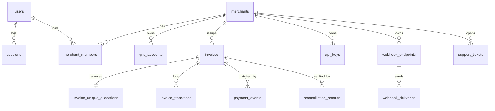

# Qrisgg — Arsitektur (Fase 1)

Status: dokumen ini menggambarkan sistem yang **benar-benar dibangun** di repo ini. Bagian bertanda *Rencana* belum diimplementasikan.

## 1. Stack (disepakati dengan pemilik)
Master prompt meminta Next.js/NestJS/PostgreSQL/Prisma/BullMQ. Platform Emergent hanya mendukung **React (CRA) + FastAPI + MongoDB**, dan pemilik menyetujui stack ini dengan syarat arsitektur modular, state machine, dan rancangan ledger tetap dipertahankan.

| Lapisan | Implementasi | Padanan di master prompt |
|---|---|---|
| Frontend | React 19, React Router (layout terpisah: marketing / auth / merchant / admin / pay), Tailwind, TanStack Query, shadcn/ui | Next.js App Router route groups |
| Backend | FastAPI modular monolith (`core/`, `modules/`), OpenAPI di `/api/docs` | NestJS modules + Swagger |
| Database | MongoDB, indeks unik/parsial, transaksi multi-dokumen bila replica set | PostgreSQL + Prisma |
| Background jobs | Loop in-process (`server.py::worker_loop`) dengan klaim atomik | Redis + BullMQ (*Rencana*) |

## 2. Struktur repository
```
backend/
  server.py                 app, middleware (request-id, CSRF origin check), error handler, seed, worker
  core/  config.py db.py security.py deps.py audit.py email.py settings_store.py
  modules/
    auth.py        register, login, 2FA TOTP, sesi, verifikasi email, reset password
    merchant.py    overview, profil, tim (RBAC), QRIS, event, audit, support
    invoices.py    invoice merchant + simulator sandbox
    payments.py    ENGINE: alokasi nominal unik, state machine, ingest event, rekonsiliasi, expiry
    providers.py   PaymentProvider, MandiriSandboxProvider, MandiriStaticQrisConfiguration, MandiriOfficialProviderAdapter (nonaktif)
    webhooks.py    HMAC-SHA256, retry backoff, dead-letter, proteksi SSRF
    developers.py  API key, endpoint webhook, Public API /api/v1
    admin.py       panel admin (MFA wajib), rekonsiliasi dengan step-up 2FA
    public.py      health, paket harga publik, halaman bayar, form kontak
frontend/src/
  layouts/ (MarketingLayout, AuthLayout, MerchantLayout, AdminLayout, AppShell)
  pages/marketing, pages/auth, pages/merchant, pages/admin, pages/Pay.jsx
infra/  compose.yaml, nginx/qrisgg.conf, scripts/{backup,restore,deploy}.sh, env.backend.example
docs/   ARCHITECTURE.md, DEPLOYMENT.md, ENVIRONMENT.md
```

## 3. Model data (koleksi MongoDB) — ERD

Koleksi lain: `auth_tokens` (TTL), `login_attempts`, `idempotency_keys` (TTL 24j), `pricing_plans`, `audit_logs`, `system_settings`, `email_logs`.
**NOT IMPLEMENTED:** `ledger_accounts`, `ledger_journals`, `ledger_lines`, `balance_holds`, `settlements`, `withdrawal_requests`, `payout_attempts`, `notification_devices`, `notification_events`, `payment_links`, `merchant_subscriptions`.

Indeks penting (lihat `core/db.py::INDEXES`):
- `invoice_unique_allocations (account_key, payable_amount)` **unik parsial** `{active: true}` → jaminan tidak ada dua invoice aktif dengan nominal bayar sama di akun QRIS yang sama.
- `payment_events.dedupe_key` unik → event duplikat ditolak.
- `invoices (merchant_id, external_id)` unik parsial.
- `api_keys.key_hash` unik; TTL untuk sesi, token, idempotency.

Uang disimpan sebagai **integer rupiah** (tidak ada float).

## 4. Payment state machine
```
CREATED → PENDING → PAYMENT_DETECTED → AWAITING_VERIFICATION → PAID_VERIFIED → (REFUNDED)
             │              │                    │
             ├→ EXPIRED ────┴→ REVIEW_REQUIRED ←─┘ → PAID_VERIFIED | FAILED | CANCELLED
             └→ CANCELLED                         AWAITING_VERIFICATION → FAILED
```
- Tabel transisi: `modules/payments.py::TRANSITIONS`. Transisi lain ditolak HTTP 409.
- Update bersyarat `{id, status: from}` mencegah race condition.
- Setiap transisi dicatat di `invoice_transitions`: from, to, event_id, source, actor_id, reason, timestamp.
- **PAID_VERIFIED hanya dari sumber `ADMIN_RECONCILIATION`** (atau `OFFICIAL_PROVIDER_CALLBACK` di masa depan). Simulator, ingest admin, dan (nanti) Android tidak dapat memverifikasi — ditegakkan di dalam fungsi `transition()`.
- Verifikasi admin membutuhkan sesi MFA + kode TOTP tambahan (step-up) + event_id yang terkait.

## 5. Alokasi nominal unik
1. Ambil nominal aktif untuk `account_key` dalam rentang `amount+min..amount+max`.
2. Acak kode bebas, `insert` ke `invoice_unique_allocations` — indeks unik parsial menolak tabrakan konkuren → coba kode berikutnya.
3. Saat invoice mencapai PAID_VERIFIED/CANCELLED/FAILED/EXPIRED, `reuse_after = now + cooldown` (default 60 menit). Worker melepas alokasi setelahnya → **delayed reuse protection**, sehingga pembayaran terlambat masih dapat dicocokkan ke invoice kedaluwarsa (→ REVIEW_REQUIRED `LATE_PAYMENT`).

## 6. Pencocokan event
`ingest_payment_event`: simpan event (dedupe) → cari alokasi aktif berdasarkan nominal → hasil: `EXACT_MATCH`, `UNDERPAYMENT`, `OVERPAYMENT`, `AMBIGUOUS_MATCH`, `LATE_PAYMENT`, `DUPLICATE_PAYMENT`, `NO_ACTIVE_INVOICE`. Nominal cocok bukan bukti settlement.

## 7. Provider
`PaymentProvider` (abstrak) dengan `get_capabilities, create_payment, get_payment_status, verify_webhook, reconcile_payment, get_settlement_status`.
- `MandiriSandboxProvider` — aktif; QR yang dihasilkan adalah string DEMO non-EMV.
- `MandiriStaticQrisConfiguration` — validasi payload QRIS statis (EMVCo TLV, tag 01=11, CRC16-CCITT).
- `MandiriOfficialProviderAdapter` — **nonaktif**; tidak ada endpoint bank yang dikarang.
- Pembatasan multi-merchant: invoice merchant hanya bisa memakai QRIS miliknya yang disetujui admin; tidak ada pooled settlement.

## 8. Keamanan (threat model ringkas)
| Ancaman | Kontrol |
|---|---|
| Pencurian kredensial | Argon2id, lockout 5x/15 menit per IP+email, cookie HttpOnly Secure |
| Session hijack | Sesi server-side dapat dicabut, rotasi refresh, cabut semua sesi saat reset password |
| CSRF (SameSite=None) | Middleware menolak request mutasi ber-cookie dari Origin di luar `CORS_ORIGINS` |
| Eskalasi hak | RBAC di backend (`require_perm`, `require_admin`), admin wajib MFA |
| Kebocoran antar tenant | Semua query merchant difilter `merchant_id` dari keanggotaan |
| Verifikasi palsu | Hanya ADMIN_RECONCILIATION + step-up TOTP yang bisa PAID_VERIFIED |
| Replay event/duplikat | `dedupe_key` unik, Idempotency-Key |
| Kebocoran secret | API key di-hash SHA-256; secret webhook & TOTP dienkripsi Fernet |
| SSRF via webhook | Hanya https, tolak IP privat/loopback, tanpa redirect |
| Open relay email | Template server-side, penerima dari database |

## 9. Milestone
| Fase | Status |
|---|---|
| 1 Arsitektur | COMPLETED (dokumen ini) |
| 2 Fondasi | COMPLETED (MongoDB; Redis/BullMQ diganti worker in-process) |
| 3 Website publik | COMPLETED |
| 4 Autentikasi | COMPLETED (email via Emergent managed Resend) |
| 5 Dashboard merchant & admin | COMPLETED (sandbox) |
| 6 Mandiri QRIS sandbox | COMPLETED |
| 7 Event & rekonsiliasi | COMPLETED (manual admin) |
| 8 Ledger & withdrawal | NOT STARTED |
| 9 Developer platform | IN PROGRESS (API key, /v1/invoices, webhook selesai; payment links, saldo belum) |
| 10 Android | NOT STARTED |
| 11 QA & deployment VPS | IN PROGRESS (artefak siap; belum dideploy ke VPS) |
| 12 Integrasi resmi Mandiri | BLOCKED (butuh dokumentasi, kredensial, otorisasi) |
